<picture>
  <source media="(prefers-color-scheme: dark)" srcset=".github/assets/header-dunkel.svg">
  
</picture>

     

<h3 align="center">Stop rewriting the agent loop.</h3>

Frameworks and SDKs, multi-agent and self-improving systems, agent UI, structured output and prompt programming, workflow automation, voice agents, sandboxes, guardrails and evals, and the courses that teach them. Picked for developers who build agents rather than only use them, and sorted by what each repo lets you build.

<!-- onboarding:start -->
### In 3 Minuten startklar

<picture>
  <source media="(prefers-color-scheme: dark)" srcset=".github/assets/onboarding-dunkel.svg">
  
</picture>

1. **Start here.** Oben unter [Start here](#start-here) stehen 4 Picks, einer je Rolle. Fang mit dem an, der zu deiner Lücke passt.
2. **Rubrik.** Unter [Contents](#contents) die Rubrik wählen: jedes Repo steht genau einmal da, nach der Aufgabe, die es erledigt.
3. **Ausprobieren.** Den Pick öffnen und seine Install-Zeile ausführen; die Sterne zeigen, wie viele ihn schon nutzen.
4. **Dranbleiben.** Dieser Liste einen Stern geben: neue Picks erscheinen in deinem GitHub-Feed.

**Was du davon hast**

- Die Repos rund um Agent Engineering an einem Ort, nach Aufgabe sortiert, statt tagelang selbst zu suchen.
- Jeder Pick sagt in einem Satz, wofür er gut ist.
- Aufgenommen wird nur, was öffentlich ist, eine Lizenz hat und heute läuft.

**Nächster Schritt:** Fehlt ein Repo? Über [CONTRIBUTING.md](CONTRIBUTING.md) vorschlagen, ein Satz zur Aufgabe genügt; mehr Listen auf [github.com/Wellux](https://github.com/Wellux).
<!-- onboarding:end -->

## Start here

No time for 369 repos? Start with these 4, one per role. Add the rest when you feel the gap.

| Role | Pick | Why |
|:--|:--|:--|
| **Framework** | [langgraph](https://github.com/langchain-ai/langgraph) `★ 44.1k` | Builds resilient agents as graphs of steps, tools and state |
| **Workflows** | [dify](https://github.com/langgenius/dify) `★ 159.9k` | Builds agentic workflows and RAG pipelines in one visual workspace |
| **Sandbox** | [E2B](https://github.com/e2b-dev/E2B) `★ 14.6k` | Runs agent-written code in secure, isolated sandboxes |
| **Evals** | [langfuse](https://github.com/langfuse/langfuse) `★ 36.7k` | Traces and evaluates LLM and agent runs on one open-source platform |

<picture>
  <source media="(prefers-color-scheme: dark)" srcset=".github/assets/map-dunkel.svg">
  
</picture>

## Contents

- [Agent frameworks and SDKs](#agent-frameworks-and-sdks) · 57 [General frameworks](#general-frameworks) · [TypeScript, Rust and Swift frameworks](#typescript-rust-and-swift-frameworks) · [Vendor SDKs, cookbooks and starters](#vendor-sdks-cookbooks-and-starters) · [Harnesses and agent runtimes](#harnesses-and-agent-runtimes)
- [Autonomous and multi-agent](#autonomous-and-multi-agent) · 42 [General autonomous agents](#general-autonomous-agents) · [Multi-agent systems](#multi-agent-systems) · [Simulations and agent societies](#simulations-and-agent-societies)
- [Self-improving and reasoning](#self-improving-and-reasoning) · 29 [Self-improving agents](#self-improving-agents) · [Reasoning patterns and recursive LMs](#reasoning-patterns-and-recursive-lms)
- [Agent UI, outputs and prompts](#agent-ui-outputs-and-prompts) · 21 [Agent UI kits and generative UI](#agent-ui-kits-and-generative-ui) · [Structured output and function calling](#structured-output-and-function-calling) · [Prompt programming and optimization](#prompt-programming-and-optimization)
- [Workflow automation](#workflow-automation) · 24 [Automation platforms](#automation-platforms) · [Visual agent builders](#visual-agent-builders)
- [Voice and realtime agents](#voice-and-realtime-agents) · 25 [Voice agent frameworks](#voice-agent-frameworks) · [Realtime and phone agents](#realtime-and-phone-agents)
- [Sandboxes, guardrails and evals](#sandboxes-guardrails-and-evals) · 100 [Sandboxes and isolation](#sandboxes-and-isolation) · [Guardrails, approvals and secrets](#guardrails-approvals-and-secrets) · [Evals and benchmarks](#evals-and-benchmarks) · [Tracing and observability](#tracing-and-observability)
- [Learn agent engineering](#learn-agent-engineering) · 71 [Agent courses and tutorials](#agent-courses-and-tutorials) · [Patterns and handbooks](#patterns-and-handbooks) · [Roadmaps and interviews](#roadmaps-and-interviews) · [AI landscape lists](#ai-landscape-lists)

## Agent frameworks and SDKs

The agent loop, already written and tested.

### General frameworks

- **[langgraph](https://github.com/langchain-ai/langgraph)** `★ 44.1k` · **Top pick.** Framework for building resilient agents.
- **[pydantic-ai](https://github.com/pydantic/pydantic-ai)** `★ 20.9k` · **Top pick.** Typed Python agent framework with realtime voice, image generation and embeddings.
- **[langchain](https://github.com/langchain-ai/langchain)** `★ 148.6k` · Agent engineering platform for building LLM agents in Python.
- **[autogen](https://github.com/microsoft/autogen)** `★ 61.6k` · Programming framework for building agentic AI applications.
- **[crewAI](https://github.com/crewAIInc/crewAI)** `★ 60.2k` · Python framework for orchestrating role-playing autonomous AI agents that collaborate.
- **[agno](https://github.com/agno-agi/agno)** `★ 42.9k` · Self-improving agent platform written in Python.
- **[deepagents](https://github.com/langchain-ai/deepagents)** `★ 30.7k` · Batteries-included agent harness built on LangChain.
- **[openai-agents-python](https://github.com/openai/openai-agents-python)** `★ 30.4k` · Lightweight Python framework for multi-agent workflows.
- **[rasa](https://github.com/RasaHQ/rasa)** `★ 21.4k` · Machine-learning framework for text and voice assistants with NLU and dialogue management.
- **[Qwen-Agent](https://github.com/QwenLM/Qwen-Agent)** `★ 17.2k` · Agent framework built on Qwen 3.0 and later with function calling, MCP, code interpreter and RAG.
- **[agent-framework](https://github.com/microsoft/agent-framework)** `★ 14.4k` · Framework for building and deploying AI agents and multi-agent workflows in Python and .NET.
- **[AutoAgent](https://github.com/HKUDS/AutoAgent)** `★ 9.8k` · Fully automated, zero-code LLM agent framework.
- **[PraisonAI](https://github.com/MervinPraison/PraisonAI)** `★ 9.3k` · Agent framework for shipping autonomous, self-improving AI agents with less boilerplate.
- **[aiwaves-cn/agents](https://github.com/aiwaves-cn/agents)** `★ 6k` · Open-source framework for data-centric, self-evolving autonomous language agents.
- **[LightAgent](https://github.com/wanxingai/LightAgent)** `★ 1.2k` · Lightweight Python framework for OpenAI-compatible agents with tools, memory and tracing.
- **[infiAgent](https://github.com/polyuiislab/infiAgent)** `★ 1.2k` · Config-driven agent framework for Cowork-style and AI-scientist agents, with skills support.
- **[AgentForge](https://github.com/DataBassGit/AgentForge)** `★ 862` · Extensible Python framework for building AI agents.
- **[intentlang](https://github.com/l3yx/intentlang)** `★ 97` · AI agent framework driven by Intent Engineering instead of turn-based function calling.
- **[FrancescoStabile/omnigent](https://github.com/FrancescoStabile/omnigent)** `★ 34` · Autonomous agent framework with a ReAct loop, multi-provider LLM routing and MCP integration.

### TypeScript, Rust and Swift frameworks

- **[ai](https://github.com/vercel/ai)** `★ 27.6k` · **Top pick.** TypeScript AI SDK for building AI-powered applications.
- **[langchainjs](https://github.com/langchain-ai/langchainjs)** `★ 18.3k` · Agent engineering platform for building LLM agents in JavaScript and TypeScript.
- **[voltagent](https://github.com/VoltAgent/voltagent)** `★ 10.9k` · Agent engineering platform built on an open-source TypeScript AI agent framework.
- **[open-multi-agent](https://github.com/open-multi-agent/open-multi-agent)** `★ 7k` · Self-hosted TypeScript agent runtime with durable approvals and verifiable run records.
- **[openai-agents-js](https://github.com/openai/openai-agents-js)** `★ 4k` · Lightweight JavaScript framework for multi-agent workflows and voice agents.
- **[agent-kit](https://github.com/inngest/agent-kit)** `★ 959` · Builds multi-agent networks in TypeScript with deterministic routing and MCP tooling.
- **[christopherkarani/Swarm](https://github.com/christopherkarani/Swarm)** `★ 586` · Swift-native agent runtime with typed tools, on-device inference and multi-agent workflows.
- **[yoagent](https://github.com/yologdev/yoagent)** `★ 366` · Rust agent loop that streams from seven LLM protocols, runs tools and loops until done.
- **[agent](https://github.com/convex/agent)** `★ 358` · TypeScript library for building AI agents on Convex with persistent chat history.

### Vendor SDKs, cookbooks and starters

- **[openai-cookbook](https://github.com/openai/openai-cookbook)** `★ 76.9k` · Examples and guides for using the OpenAI API.
- **[claude-cookbooks](https://github.com/anthropics/claude-cookbooks)** `★ 53.9k` · Notebooks and recipes showing effective ways to use Claude.
- **[claude-quickstarts](https://github.com/anthropics/claude-quickstarts)** `★ 19k` · Starter projects for building deployable applications with Claude.
- **[generative-ai](https://github.com/GoogleCloudPlatform/generative-ai)** `★ 17.8k` · Sample code and notebooks for generative AI on Google Cloud.
- **[claude-agent-sdk-python](https://github.com/anthropics/claude-agent-sdk-python)** `★ 8.4k` · Official Python SDK for building agents with Claude.
- **[agents-cli](https://github.com/google/agents-cli)** `★ 6.2k` · CLI and skills that let a coding assistant create, evaluate and deploy AI agents on Google Cloud.
- **[GenerativeAIExamples](https://github.com/NVIDIA/GenerativeAIExamples)** `★ 4.2k` · Generative AI reference workflows for accelerated infrastructure and microservices.
- **[ai-getting-started](https://github.com/a16z-infra/ai-getting-started)** `★ 4.1k` · JavaScript starter stack for AI weekend projects with models, vector stores, auth and deploy.
- **[claude-agent-sdk-demos](https://github.com/anthropics/claude-agent-sdk-demos)** `★ 2.8k` · Demo applications for the Claude Agent SDK.
- **[server-bot-quick-start](https://github.com/poe-platform/server-bot-quick-start)** `★ 1.3k` · Tutorial for building server bots on the Poe platform.
- **[microsoft/Agents](https://github.com/microsoft/Agents)** `★ 1.1k` · Microsoft 365 Agent SDK for building multichannel, trusted agents for M365 and other platforms.
- **[teams-sdk](https://github.com/microsoft/teams-sdk)** `★ 733` · SDK for building AI-based apps and extensions for Microsoft Teams and Bot Framework channels.
- **[single-agent-loop-kit](https://github.com/anthropics/single-agent-loop-kit)** `★ 345` · Starter kit for folding subagents into one agent loop of skills and tools, measured by evals.

### Harnesses and agent runtimes

- **[openhuman](https://github.com/tinyhumansai/openhuman)** `★ 42.4k` · Open-source agent harness built to run hundreds of agents cheaply on a small VPS.
- **[OpenHarness](https://github.com/HKUDS/OpenHarness)** `★ 16.1k` · Agent harness with a built-in personal agent called Ohmo.
- **[ax](https://github.com/google/ax)** `★ 14.3k` · Google's open agentic orchestration runtime, called the Agent Executor.
- **[hive](https://github.com/aden-hive/hive)** `★ 11.1k` · Multi-agent harness for running AI agents in production.
- **[omnigent-ai/omnigent](https://github.com/omnigent-ai/omnigent)** `★ 11.1k` · Agent framework and meta-harness that orchestrates Claude Code, Codex, Cursor, Pi and custom agents.
- **[maka](https://github.com/apache/maka)** `★ 5.9k` · Agent runtime and workspace that keeps a complete record of everything the agent did.
- **[Raven](https://github.com/EverMind-AI/Raven)** `★ 5.9k` · Harness of harnesses for persistent, self-evolving multi-agent systems built for self-improvement.
- **[harnessrouter](https://github.com/HarnessRouter/harnessrouter)** `★ 3.8k` · Self-hosted Apache-2.0 edition of a unified interface for running agent harnesses.
- **[connectonion](https://github.com/openonion/connectonion)** `★ 1.5k` · Agent harness built around the command line.
- **[headlong](https://github.com/laude-institute/headlong)** `★ 1.3k` · Shell-based agent microharness with persistent agency and recursive LLM calls.
- **[cuga-agent](https://github.com/cuga-project/cuga-agent)** `★ 1.1k` · Generalist enterprise agent harness for web and API tasks with OpenAPI and MCP integrations.
- **[sandbase-harness](https://github.com/sandbaseai/sandbase-harness)** `★ 636` · Local-first agent runtime and MCP bridge with sandboxed sessions, memory, credentials and replay.
- **[opencomputer](https://github.com/diggerhq/opencomputer)** `★ 575` · Platform and CLI for building, steering and deploying serverless agents as code.
- **[aiming-lab/AutoHarness](https://github.com/aiming-lab/AutoHarness)** `★ 464` · Automated harness engineering for AI agents.
- **[wakegate](https://github.com/shitianfang/wakegate)** `★ 6` · Asks Jev whether waking a sleeping agent is worth a full LLM turn, and fails open.
- **[treadle](https://github.com/zby/treadle)** `★ 4` · Write workflows in Pydantic AI and run them through Claude Code, Codex, pi or any agent harness.

<a href="#contents">back to contents</a>

## Autonomous and multi-agent

Agents that work alone, in teams or in simulated towns.

### General autonomous agents

- **[deer-flow](https://github.com/bytedance/deer-flow)** `★ 84.6k` · **Top pick.** Long-horizon agent harness that researches, codes and creates, with sandboxes and memory.
- **[AutoGPT](https://github.com/Significant-Gravitas/AutoGPT)** `★ 187.8k` · Accessible AI tools for using and building autonomous agents.
- **[JARVIS](https://github.com/microsoft/JARVIS)** `★ 25.5k` · System that connects LLMs with models from the ML community to solve tasks.
- **[owl](https://github.com/camel-ai/owl)** `★ 20.2k` · Multi-agent assistant that automates real-world tasks, from CAMEL-AI.
- **[SuperAGI](https://github.com/TransformerOptimus/SuperAGI)** `★ 17.7k` · Open-source framework for building, managing and running autonomous AI agents.
- **[AGiXT](https://github.com/Josh-XT/AGiXT)** `★ 3.2k` · AI agent automation platform that orchestrates instructions and complex task execution.
- **[AutoGPT-Next-Web](https://github.com/ElricLiu/AutoGPT-Next-Web)** `★ 3k` · Browser app to assemble, configure and deploy your own autonomous AI agents.
- **[OpenAGI](https://github.com/agiresearch/OpenAGI)** `★ 2.3k` · Research platform that pairs an LLM with domain-expert models.
- **[AutoGPT.js](https://github.com/zabirauf/AutoGPT.js)** `★ 1k` · Runs the Auto-GPT agent loop in the browser.
- **[Auto-GPT-Plugin-Template](https://github.com/Significant-Gravitas/Auto-GPT-Plugin-Template)** `★ 786` · Starting point for developing your own plugin for Auto-GPT.
- **[Auto-GPT-MetaTrader-Plugin](https://github.com/isaiahbjork/Auto-GPT-MetaTrader-Plugin)** `★ 564` · Auto-GPT plugin that connects a MetaTrader 4 or 5 trading account to the agent.
- **[Auto-GPT-Crypto-Plugin](https://github.com/isaiahbjork/Auto-GPT-Crypto-Plugin)** `★ 275` · Auto-GPT plugin that connects a crypto wallet or exchange to the agent.
- **[Auto-GPT-Notion](https://github.com/doutv/Auto-GPT-Notion)** `★ 188` · Auto-GPT plugin that connects the agent to Notion.
- **[autogpt-package](https://github.com/kurtosis-tech/autogpt-package)** `★ 164` · Kurtosis package that starts AutoGPT quickly with the backend of your choice.
- **[AutoGPT-YouTube](https://github.com/jpetzke/AutoGPT-YouTube)** `★ 124` · AutoGPT plugin for YouTube tasks such as downloading videos.
- **[solvent-agent](https://github.com/ianalloway/solvent-agent)** `★ 111` · Offline-first Python agent that runs a small research business, quoting jobs against its own costs.
- **[AutoGPTCommands](https://github.com/alexfacehead/AutoGPTCommands)** `★ 74` · AutoGPT variant with added commands and read, write and delete file access.
- **[Auto-GPT-Google-Analytics-Plugin](https://github.com/isaiahbjork/Auto-GPT-Google-Analytics-Plugin)** `★ 61` · Auto-GPT plugin that connects Google Analytics to the agent.

### Multi-agent systems

- **[MetaGPT](https://github.com/FoundationAgents/MetaGPT)** `★ 71.1k` · **Top pick.** Multi-agent framework that works as an AI software company.
- **[ruflo](https://github.com/ruvnet/ruflo)** `★ 80k` · Agent harness for deploying multi-agent swarms and coordinating autonomous workflows.
- **[buzz](https://github.com/block/buzz)** `★ 36.5k` · Self-hostable workspace where humans and AI agents share rooms on a relay you own.
- **[ChatDev](https://github.com/OpenBMB/ChatDev)** `★ 34.6k` · Develops software through LLM-powered multi-agent collaboration.
- **[openai/swarm](https://github.com/openai/swarm)** `★ 22.1k` · Educational framework for exploring lightweight multi-agent orchestration.
- **[AgentTeams](https://github.com/agentscope-ai/AgentTeams)** `★ 5.9k` · Multi-agent OS for human-in-the-loop task coordination through Matrix rooms.
- **[ROMA](https://github.com/sentient-agi/ROMA)** `★ 5.2k` · Recursive meta-agent framework for building multi-agent systems.
- **[AgentVerse](https://github.com/OpenBMB/AgentVerse)** `★ 5.2k` · Framework for deploying multiple LLM-based agents across applications.
- **[agency-swarm](https://github.com/VRSEN/agency-swarm)** `★ 4.6k` · Framework for reliable multi-agent orchestration.
- **[openagents](https://github.com/openagents-org/openagents)** `★ 4.3k` · Collaboration OS and network for AI agents.
- **[AutoSwarm](https://github.com/HKUDS/AutoSwarm)** `★ 2.1k` · Turns Codex, Claude Code, DeepSeek Harness, Grok and other agents into one coordinated team.
- **[flock](https://github.com/Onelevenvy/flock)** `★ 1.1k` · Desktop multi-agent harness built with Rust, Tauri and React on langgraph-rust.
- **[Multi-Agent-Custom-Automation-Engine-Solution-Accelerator](https://github.com/microsoft/Multi-Agent-Custom-Automation-Engine-Solution-Accelerator)** `★ 892` · Solution accelerator for a system that manages a group of AI agents to accomplish tasks.
- **[room](https://github.com/quoroom-ai/room)** `★ 834` · Swarm engine of self-governing AI collectives with a queen, workers and quorum voting.
- **[swarmclaw](https://github.com/swarmclawai/swarmclaw)** `★ 701` · Self-hosted agent runtime and multi-agent framework for swarms, with memory and MCP tools.
- **[fractals](https://github.com/TinyAGI/fractals)** `★ 647` · Recursive task orchestrator for a swarm of agents.
- **[big-3-super-agent](https://github.com/disler/big-3-super-agent)** `★ 294` · Multi-agent experiment combining Gemini 2.5 Computer Use, OpenAI Realtime API and Claude Code.
- **[spynel](https://github.com/agent0ai/spynel)** `★ 211` · Single chat assistant that orchestrates many agents through your existing coding harnesses.
- **[Drift](https://github.com/ashhart/Drift)** `★ 21` · Experimental memory link that lets frozen language models share working memory via KV caches.

### Simulations and agent societies

- **[ai-town](https://github.com/a16z-infra/ai-town)** `★ 10.7k` · **Top pick.** Deployable MIT-licensed starter kit for a virtual town populated by AI characters.
- **[generative_agents](https://github.com/joonspk-research/generative_agents)** `★ 22.3k` · Research code for generative agents that simulate believable human behavior.
- **[xianxia-AI-town-AI-](https://github.com/zblcving9-gif/xianxia-AI-town-AI-)** `★ 1.2k` · Xianxia town game where LLMs drive NPC decisions and NPCs and players have equal standing.
- **[my_ai_town](https://github.com/mewamew/my_ai_town)** `★ 949` · AI town simulation project written in Rust.
- **[OpenPixel-RPG](https://github.com/tensor2023/OpenPixel-RPG)** `★ 228` · AI-powered pixel-art JRPG that turns a place or photo and a style into a playable world.

<a href="#contents">back to contents</a>

## Self-improving and reasoning

Agents that rewrite their own playbook.

### Self-improving agents

- **[harness2](https://github.com/google-research/harness2)** `★ 21k` · **Top pick.** Framework that recursively refines an agent harness per task and across tasks.
- **[GenericAgent](https://github.com/lsdefine/GenericAgent)** `★ 14.4k` · **Top pick.** Self-evolving agent that grows its own skill tree from a small seed.
- **[reef](https://github.com/Human-Agent-Society/reef)** `★ 7.8k` · Infrastructure for agents that keep improving themselves over time.
- **[automaton](https://github.com/Conway-Research/automaton)** `★ 7.6k` · Autonomous AI agent that aims to earn its own existence, replicate and evolve without a human.
- **[penguin-harness](https://github.com/Prism-Shadow/penguin-harness)** `★ 3k` · Unified and stable platform for recursive self-improvement of agents.
- **[HyperAgents](https://github.com/facebookresearch/HyperAgents)** `★ 2.8k` · Self-referential, self-improving agents that can optimize for any computable task.
- **[agentic-context-engine](https://github.com/kayba-ai/agentic-context-engine)** `★ 2.6k` · Adds a persistent learning loop so agents learn from what worked and what failed.
- **[NeoHorse](https://github.com/TokenRhythm/NeoHorse)** `★ 1.7k` · Research on recursive self-improvement through agentic post-training with a routing harness.
- **[ouroboros](https://github.com/razzant/ouroboros)** `★ 1.6k` · Self-creating autonomous AI agent.
- **[Memento-Skills](https://github.com/Memento-Teams/Memento-Skills)** `★ 1.6k` · Lets agents design other agents, built around skills.
- **[exo](https://github.com/exoharness/exo)** `★ 1.5k` · Agent and harness architecture that is fully recursive and can safely edit itself at runtime.
- **[Dream-RSI](https://github.com/zhengkid/Dream-RSI)** `★ 1.5k` · Official repo for Dream-RSI, recursive self-improvement through evolving worlds.
- **[autocontext](https://github.com/greyhaven-ai/autocontext)** `★ 1.3k` · Recursive self-improving harness that helps agents and their future versions succeed.
- **[SkillRL](https://github.com/aiming-lab/SkillRL)** `★ 1k` · NeurIPS research code for evolving agents with recursive skill-augmented reinforcement learning.
- **[awesome-rsi](https://github.com/lobehub/awesome-rsi)** `★ 897` · Curated research map of recursive self-improvement across models, agents, harnesses and robots.
- **[OpenRSI](https://github.com/FrontisAI/OpenRSI)** `★ 860` · Executable, reproducible AI-for-AI work toward recursive self-improvement.
- **[RSIAgent](https://github.com/AetherLabsAI/RSIAgent)** `★ 576` · Training-free multi-agent framework for recursive self-improvement in new environments.
- **[kayba-ai/autoharness](https://github.com/kayba-ai/autoharness)** `★ 312` · Improves an agent harness autonomously overnight.
- **[mue-x](https://github.com/KorroAi/mue-x)** `★ 279` · Self-evolving agent that rewrites its own source code using AST mutation strategies.
- **[Godel_Agent](https://github.com/Arvid-pku/Godel_Agent)** `★ 240` · Self-referential agent framework for recursive self-improvement.
- **[HyperSkill](https://github.com/rux001/HyperSkill)** `★ 53` · Research code for self-evolving LLM agents that use hypergraph-structured skill memory.

### Reasoning patterns and recursive LMs

- **[rlm](https://github.com/alexzhang13/rlm)** `★ 5.7k` · **Top pick.** Plug-and-play inference library for Recursive Language Models with support for various sandboxes.
- **[tree-of-thoughts](https://github.com/kyegomez/tree-of-thoughts)** `★ 4.6k` · Plug-and-play implementation of Tree of Thoughts for deliberate problem solving with LLMs.
- **[reflexion](https://github.com/noahshinn/reflexion)** `★ 3.4k` · NeurIPS 2023 code for Reflexion, language agents that learn through verbal reinforcement.
- **[Chain-of-Recursive-Thoughts](https://github.com/PhialsBasement/Chain-of-Recursive-Thoughts)** `★ 2.3k` · Makes an LLM think harder by having it argue with itself over repeated rounds.
- **[ReCode](https://github.com/FoundationAgents/ReCode)** `★ 572` · Unifies LLM agent planning and action through recursive code generation.
- **[llm_multiagent_debate](https://github.com/composable-models/llm_multiagent_debate)** `★ 556` · ICML 2024 code for improving LLM factuality and reasoning through multiagent debate.
- **[recursive_llm](https://github.com/andyk/recursive_llm)** `★ 243` · Implements recursion with English as the programming language and an LLM as the runtime.
- **[aleph](https://github.com/Hmbown/aleph)** `★ 219` · Skill and MCP server that turn an agent into a recursive language model.

<a href="#contents">back to contents</a>

## Agent UI, outputs and prompts

Front ends for agents, typed outputs and prompts you can optimize.

### Agent UI kits and generative UI

- **[CopilotKit](https://github.com/CopilotKit/CopilotKit)** `★ 38.3k` · **Top pick.** Frontend stack for agents and generative UI in React, Angular and mobile, from the makers of AG-UI.
- **[assistant-ui](https://github.com/assistant-ui/assistant-ui)** `★ 12.8k` · TypeScript and React library for AI chat.
- **[OpenIntelligentUI](https://github.com/CopilotKit/OpenIntelligentUI)** `★ 4k` · Open-source generative UI framework for agent-native applications.
- **[solid-glass](https://github.com/deeplethe/solid-glass)** `★ 2k` · Design system for AI applications with a material, tactile and technical look.
- **[realtime-voice-component](https://github.com/openai/realtime-voice-component)** `★ 885` · React and browser voice controls for tool-constrained UIs built on OpenAI Realtime.

### Structured output and function calling

- **[instructor](https://github.com/567-labs/instructor)** `★ 14.1k` · **Top pick.** Python library for validated structured outputs from LLMs using Pydantic.
- **[outlines](https://github.com/dottxt-ai/outlines)** `★ 16k` · Library for structured outputs from LLMs.
- **[gorilla](https://github.com/ShishirPatil/gorilla)** `★ 13.1k` · Trains and evaluates LLMs for function calling and tool use.
- **[baml](https://github.com/BoundaryML/baml)** `★ 9.5k` · Programming language for building agents and LLM functions with structured, typed outputs.
- **[ToolBench](https://github.com/OpenBMB/ToolBench)** `★ 5.8k` · Open platform for training, serving and evaluating LLMs for tool learning.
- **[json_repair](https://github.com/mangiucugna/json_repair)** `★ 5.1k` · Repairs malformed JSON from LLMs, APIs, logs and user input in Python.
- **[Hermes-Function-Calling](https://github.com/NousResearch/Hermes-Function-Calling)** `★ 1.5k` · Function-calling and JSON-mode code for Nous Research's Hermes Pro models.

### Prompt programming and optimization

- **[dspy](https://github.com/stanfordnlp/dspy)** `★ 38.8k` · **Top pick.** Framework for programming, not prompting, language models.
- **[OpenPrompt](https://github.com/thunlp/OpenPrompt)** `★ 4.9k` · Open-source framework for prompt-learning in natural language processing.
- **[PromptWizard](https://github.com/microsoft/PromptWizard)** `★ 4k` · Task-aware, agent-driven framework for optimizing prompts.
- **[textgrad](https://github.com/zou-group/textgrad)** `★ 3.8k` · Optimizes prompts and compound AI systems by backpropagating textual gradients from LLMs.
- **[AutoPrompt](https://github.com/Eladlev/AutoPrompt)** `★ 3k` · Framework that tunes prompts through intent-based prompt calibration.
- **[priompt](https://github.com/anysphere/priompt)** `★ 2.9k` · TypeScript library for designing prompts with JSX.
- **[automatic_prompt_engineer](https://github.com/keirp/automatic_prompt_engineer)** `★ 1.4k` · Automatically generates and selects prompts with large language models.
- **[sammo](https://github.com/microsoft/sammo)** `★ 783` · Library for prompt engineering and structure-aware multi-objective metaprompt optimization.
- **[rulesmith](https://github.com/bradAGI/rulesmith)** `★ 12` · Uses DSPy to build a readable rules file, with a small judge model handling the hard cases.

<a href="#contents">back to contents</a>

## Workflow automation

Deterministic workflows for the routine, agents for the thinking.

### Automation platforms

- **[n8n](https://github.com/n8n-io/n8n)** `★ 208.9k` · **Top pick.** Workflow automation with native AI nodes, self-hostable.
- **[conductor](https://github.com/conductor-oss/conductor)** `★ 32.4k` · Event-driven agentic workflow engine with durable, resilient execution.
- **[kestra](https://github.com/kestra-io/kestra)** `★ 30.1k` · Open-source control plane for workflows across data, infrastructure and business processes.
- **[activepieces](https://github.com/activepieces/activepieces)** `★ 25.3k` · Open-source automation with MCP support.
- **[rocketride-server](https://github.com/rocketride-org/rocketride-server)** `★ 18.5k` · AI pipeline engine with a C++ core and 50+ Python-extensible nodes for building LLM workflows.
- **[windmill](https://github.com/windmill-labs/windmill)** `★ 18.3k` · Self-hostable platform for code-first workflows, internal apps and AI agents.
- **[trigger.dev](https://github.com/triggerdotdev/trigger.dev)** `★ 16.6k` · Platform to build and deploy durable AI agents and workflows.
- **[hatchet](https://github.com/hatchet-dev/hatchet)** `★ 8.2k` · Orchestration engine for background tasks, AI agents and durable workflows.
- **[julep](https://github.com/julep-ai/julep)** `★ 6.6k` · Durable, composable AI agent flows that resume after crashes and explain every step.
- **[inngest](https://github.com/inngest/inngest)** `★ 6k` · Workflow platform that runs stateful step functions and AI workflows on serverless or servers.
- **[awesome-workflow-automation](https://github.com/dariubs/awesome-workflow-automation)** `★ 1.3k` · Curated list of workflow automation software, engines and tools.
- **[power-automate-docs](https://github.com/MicrosoftDocs/power-automate-docs)** `★ 381` · Source of Microsoft's Power Automate product documentation, published on Microsoft Learn.
- **[examples](https://github.com/triggerdotdev/examples)** `★ 127` · Trigger.dev example projects to fork and run.
- **[docker](https://github.com/triggerdotdev/docker)** `★ 93` · Templates for self-hosting the Trigger.dev platform and running it locally in containers.
- **[api-reference](https://github.com/triggerdotdev/api-reference)** `★ 9` · Job code samples for Trigger.dev that call external APIs through SDKs or fetch.

### Visual agent builders

- **[dify](https://github.com/langgenius/dify)** `★ 159.9k` · **Top pick.** Build and run agentic workflows visually.
- **[langflow](https://github.com/langflow-ai/langflow)** `★ 156.1k` · **Top pick.** Visual builder for agents and RAG flows.
- **[FastGPT](https://github.com/labring/FastGPT)** `★ 29.9k` · Knowledge-based platform built on LLMs with out-of-the-box capabilities for AI apps and agents.
- **[coze-studio](https://github.com/coze-dev/coze-studio)** `★ 21.8k` · Visual AI agent development platform for building, debugging and deploying agents.
- **[botpress](https://github.com/botpress/botpress)** `★ 15k` · Open-source platform to build and deploy LLM-powered agents and chatbots.
- **[promptflow](https://github.com/microsoft/promptflow)** `★ 11.3k` · Tool suite for building LLM apps from prototyping and testing to deployment and monitoring.
- **[pyspur](https://github.com/PySpur-Dev/pyspur)** `★ 5.8k` · Visual playground for building and iterating on agentic workflows.
- **[databerry](https://github.com/gmpetrov/databerry)** `★ 3k` · No-code platform for building custom LLM agents.
- **[LLMStack](https://github.com/trypromptly/LLMStack)** `★ 2.3k` · No-code multi-agent framework for building LLM agents, workflows and applications with your data.

<a href="#contents">back to contents</a>

## Voice and realtime agents

Agents that listen, speak and interrupt like people.

### Voice agent frameworks

- **[pipecat](https://github.com/pipecat-ai/pipecat)** `★ 16.9k` · **Top pick.** Open-source framework for voice agents, multimodal apps and realtime AI.
- **[livekit/agents](https://github.com/livekit/agents)** `★ 15k` · **Top pick.** Framework for building realtime voice and video AI agents.
- **[livekit](https://github.com/livekit/livekit)** `★ 21.9k` · Scalable Go WebRTC SFU that moves realtime audio, video and data between people and AI models.
- **[speech-to-speech](https://github.com/huggingface/speech-to-speech)** `★ 13.6k` · Pipeline for building voice agents with open-source models.
- **[ten-framework](https://github.com/TEN-framework/ten-framework)** `★ 11.2k` · Open-source framework for conversational voice AI agents.
- **[Vision-Agents](https://github.com/GetStream/Vision-Agents)** `★ 8.2k` · Framework for voice and vision agents that works with any model or video provider.
- **[vocode-core](https://github.com/vocodedev/vocode-core)** `★ 3.8k` · Modular open-source framework for building voice-based LLM agents.
- **[qwen-audio-agent](https://github.com/QwenAudio/qwen-audio-agent)** `★ 3k` · Realtime voice runtime that keeps AI agents talking and working.
- **[agents-js](https://github.com/livekit/agents-js)** `★ 952` · Node.js framework for building realtime multimodal AI agents.
- **[pipecat-examples](https://github.com/pipecat-ai/pipecat-examples)** `★ 403` · Example apps showing patterns for building voice AI applications with Pipecat.

### Realtime and phone agents

- **[openai-realtime-agents](https://github.com/openai/openai-realtime-agents)** `★ 7k` · **Top pick.** Demo of advanced agentic patterns built on top of the Realtime API.
- **[openai-realtime-console](https://github.com/openai/openai-realtime-console)** `★ 3.6k` · React app for inspecting, building and debugging with the Realtime API.
- **[openai-realtime-embedded](https://github.com/openai/openai-realtime-embedded)** `★ 1.6k` · Guide to using the Realtime API on microcontrollers and embedded platforms.
- **[Tel-Agent](https://github.com/Dpro-at/Tel-Agent)** `★ 1.2k` · Open-source AI phone assistant.
- **[realtime-phone-agents-course](https://github.com/neural-maze/realtime-phone-agents-course)** `★ 1.1k` · Course for building realtime voice agents with FastRTC, Superlinked vector search and Twilio.
- **[poc-realtime-ai-assistant](https://github.com/disler/poc-realtime-ai-assistant)** `★ 718` · Early versions of Ada, a personal AI assistant built on the OpenAI Realtime API.
- **[aisearch-openai-rag-audio](https://github.com/Azure-Samples/aisearch-openai-rag-audio)** `★ 564` · Example VoiceRAG implementation for interactive voice AI experiences using RAG on Azure.
- **[gemini-live-api-examples](https://github.com/google-gemini/gemini-live-api-examples)** `★ 564` · Examples for building realtime voice and vision agents with Gemini Live.
- **[speech-assistant-openai-realtime-api-node](https://github.com/twilio-samples/speech-assistant-openai-realtime-api-node)** `★ 363` · Node.js phone speech assistant that connects Twilio calls to the OpenAI Realtime API.
- **[claude-phone](https://github.com/theNetworkChuck/claude-phone)** `★ 342` · Voice interface for Claude Code over SIP and 3CX: call your AI and it can call you.
- **[gemini-multimodal-playground](https://github.com/saharmor/gemini-multimodal-playground)** `★ 328` · Playground for building realtime voice and video agents with Google's Gemini 2.0.
- **[personal-ai-starter-pack](https://github.com/disler/personal-ai-starter-pack)** `★ 201` · Starter combining fast speech-to-text, an LLM and text-to-speech for personal AI assistants.
- **[openai-realtime-api-voice-assistant-V2](https://github.com/Barty-Bart/openai-realtime-api-voice-assistant-V2)** `★ 134` · Voice agent on the OpenAI Realtime API with RAG, function calling and caller history.
- **[live-translation-openai-realtime-api](https://github.com/twilio-samples/live-translation-openai-realtime-api)** `★ 125` · Starter app for live voice translation in a Twilio Flex contact center with OpenAI Realtime.
- **[vox](https://github.com/steipete/vox)** `★ 97` · Lets an agent run phone calls from the command line.

<a href="#contents">back to contents</a>

## Sandboxes, guardrails and evals

Autonomy needs a kill switch, a sandbox and a scoreboard.

### Sandboxes and isolation

- **[E2B](https://github.com/e2b-dev/E2B)** `★ 14.6k` · **Top pick.** Open-source infrastructure that runs AI-generated code in secure, isolated cloud sandboxes.
- **[NemoClaw](https://github.com/NVIDIA/NemoClaw)** `★ 22.9k` · Run Hermes, OpenClaw and friends inside a secured sandbox.
- **[OpenShell](https://github.com/NVIDIA/OpenShell)** `★ 20.6k` · Safe, private runtime for autonomous AI agents.
- **[OpenSandbox](https://github.com/opensandbox-group/OpenSandbox)** `★ 16.2k` · Secure, extensible sandbox runtime for AI agents with Kubernetes support.
- **[substrate](https://github.com/agent-substrate/substrate)** `★ 5.9k` · Zero-trust runtime that sandboxes and resumes very large numbers of agents on Kubernetes.
- **[agentos](https://github.com/rivet-dev/agentos)** `★ 4.8k` · Tiny, fast, Linux-compatible sandboxes for agents, powered by WebAssembly.
- **[nono](https://github.com/nolabs-ai/nono)** `★ 4.7k` · Zero-trust sandboxing for agent runtimes, with no setup.
- **[arcbox](https://github.com/arcboxlabs/arcbox)** `★ 4.3k` · Runs AI agents on isolated machines with their own kernel, filesystem and network.
- **[AgentENV](https://github.com/kvcache-ai/AgentENV)** `★ 3.7k` · Distributed platform that runs agent environments at scale in Firecracker microVMs.
- **[open-terminal](https://github.com/open-webui/open-terminal)** `★ 3.4k` · Self-hosted terminal API where AI agents run commands, manage files and execute code.
- **[mxc](https://github.com/microsoft/mxc)** `★ 3k` · Microsoft sandbox SDK that contains untrusted code such as model output, plugins and tools.
- **[layerfs](https://github.com/Ephemeral-AI-Lab/layerfs)** `★ 2.5k` · Gives each agent a writable copy-on-write filesystem workspace with shared durable history.
- **[vibekit](https://github.com/superagent-ai/vibekit)** `★ 1.9k` · Runs Claude Code, Gemini, Codex or any coding agent in an isolated sandbox with data redaction.
- **[desktop](https://github.com/e2b-dev/desktop)** `★ 1.5k` · Sandbox with a graphical desktop environment that any LLM can control securely.
- **[ai-jail](https://github.com/akitaonrails/ai-jail)** `★ 1.4k` · Multi-OS sandbox for running AI agents with tighter constraints.
- **[vibe](https://github.com/lynaghk/vibe)** `★ 960` · Easy Linux virtual machine on macOS that sandboxes LLM agents.
- **[quicksand](https://github.com/microsoft/quicksand)** `★ 397` · Python tool for quickly putting an AI agent inside a sandbox.
- **[agent-sandbox-skill](https://github.com/disler/agent-sandbox-skill)** `★ 391` · Agent skill for managing isolated execution environments.

### Guardrails, approvals and secrets

- **[SkillSpector](https://github.com/NVIDIA/SkillSpector)** `★ 23.1k` · Scans agent skills for vulnerabilities, malicious patterns and prompt injection.
- **[guardrails-ai/guardrails](https://github.com/guardrails-ai/guardrails)** `★ 7.6k` · Python framework for adding guardrails to large language model applications.
- **[NVIDIA-NeMo/Guardrails](https://github.com/NVIDIA-NeMo/Guardrails)** `★ 7.4k` · Toolkit for adding programmable guardrails to LLM-based conversational systems.
- **[superagent](https://github.com/superagent-ai/superagent)** `★ 6.8k` · Protects AI apps against prompt injection, data leaks and harmful outputs.
- **[agent-governance-toolkit](https://github.com/microsoft/agent-governance-toolkit)** `★ 6.5k` · Policy enforcement, zero-trust identity and execution sandboxing for AI agents.
- **[varlock](https://github.com/dmno-dev/varlock)** `★ 4.9k` · AI-safe .env files with schemas for agents and secrets for humans.
- **[agent-vault](https://github.com/Infisical/agent-vault)** `★ 2.4k` · HTTP credential proxy and vault for AI agents such as Claude Code, OpenClaw and Hermes.
- **[valqore](https://github.com/valqore/valqore)** `★ 1.9k` · Safety-first guardrails for AI-driven cloud and Kubernetes operations.
- **[cc-safety-net](https://github.com/kenryu42/cc-safety-net)** `★ 1.8k` · Pre-execution guard that blocks destructive Git and file system commands from coding agents.
- **[OpenAPPA](https://github.com/archestra-ai/OpenAPPA)** `★ 1.6k` · Deterministic guardrails that do not break agents.
- **[akto](https://github.com/akto-api-security/akto)** `★ 1.5k` · Security platform for AI agents, MCP servers, LLMs and agent skills.
- **[agentshield](https://github.com/affaan-m/agentshield)** `★ 1.3k` · Security scanner that finds vulnerabilities in AI agent configurations.
- **[DataInfra-RedactionEverything](https://github.com/ttttccxxui/DataInfra-RedactionEverything)** `★ 1.1k` · Local-first workbench that redacts sensitive data in documents, PDFs and images with local LLMs.
- **[medusa](https://github.com/Pantheon-Security/medusa)** `★ 1k` · AI-first security scanner that also vets Claude Code hooks, permissions and skills.
- **[pipelock](https://github.com/pipelab-org/pipelock)** `★ 967` · Agent firewall for MCP and egress that scans HTTP, MCP, A2A and WebSocket traffic.
- **[shellfirm](https://github.com/kaplanelad/shellfirm)** `★ 949` · Safety guardrails that check risky terminal commands from AI coding agents and humans.
- **[hoop](https://github.com/hoophq/hoop)** `★ 839` · Runtime enforcement that masks sensitive data and blocks destructive commands from AI agents.
- **[MCP-Security-Checklist](https://github.com/slowmist/MCP-Security-Checklist)** `★ 831` · Security checklist for MCP-based AI tools and LLM plugin ecosystems.
- **[agent-safe-pipeline](https://github.com/decionis/agent-safe-pipeline)** `★ 672` · Execution-authority gateway that intercepts consequential HTTP actions from AI agents and APIs.
- **[claude-code-damage-control](https://github.com/disler/claude-code-damage-control)** `★ 480` · Safety hooks for Claude Code that guard against damaging agent actions.
- **[agentseal](https://github.com/getagentseal/agentseal)** `★ 380` · Scans your machine for dangerous skills and MCP configs and watches for supply chain attacks.
- **[agent-control](https://github.com/agentcontrol/agent-control)** `★ 332` · Central control plane that governs runtime agent behavior with configurable guardrails.
- **[agent-audit](https://github.com/HeadyZhang/agent-audit)** `★ 242` · Static security scanner for LLM agents: prompt injection, MCP config audits and taint analysis.
- **[prompt-guard](https://github.com/seojoonkim/prompt-guard)** `★ 180` · Prompt injection defense for AI agents with multi-language detection and severity scores.
- **[agent-blackbox](https://github.com/umanitek/agent-blackbox)** `★ 64` · Guardian that keeps AI agents from being tricked or compromised.
- **[fluegel](https://github.com/steipete/fluegel)** `★ 45` · macOS menu bar app that runs whitelisted CLI tools with privacy permissions for local agents.
- **[litellm-guardrails](https://github.com/BerriAI/litellm-guardrails)** `★ 17` · Registry of public custom code guardrails for the LiteLLM proxy server.

### Evals and benchmarks

- **[deepeval](https://github.com/confident-ai/deepeval)** `★ 19.2k` · **Top pick.** Framework for evaluating LLM applications with a library of evaluation metrics.
- **[iFixAi](https://github.com/ifixai-ai/iFixAi)** `★ 37.1k` · Independent audits of AI agents, run by a human or by the agent itself.
- **[promptfoo](https://github.com/promptfoo/promptfoo)** `★ 26.6k` · Tests prompts, agents and RAG apps, with red teaming and vulnerability scans built in.
- **[openai/evals](https://github.com/openai/evals)** `★ 19.7k` · Framework for evaluating LLMs and LLM systems, plus an open-source registry of benchmarks.
- **[ragas](https://github.com/vibrantlabsai/ragas)** `★ 16.2k` · Toolkit for evaluating LLM applications.
- **[arc-task-gen](https://github.com/pathwaycom/arc-task-gen)** `★ 10.9k` · Generates original ARC-AGI-1-style tasks matched to the distribution of the public eval set.
- **[ClawWork](https://github.com/HKUDS/ClawWork)** `★ 8.6k` · Economic benchmark where agents pay for tokens and earn wage-priced income on 220 GDPVal tasks.
- **[opencompass](https://github.com/open-compass/opencompass)** `★ 7.6k` · LLM evaluation platform supporting models from OpenAI, Anthropic, Gemini, Qwen, GLM and more.
- **[harbor](https://github.com/harbor-framework/harbor)** `★ 6.6k` · Framework for evaluating and improving agents with evals and RL environments.
- **[SWE-bench](https://github.com/SWE-bench/SWE-bench)** `★ 6.1k` · Benchmark of real GitHub issues that tests whether language models can resolve them.
- **[Kiln](https://github.com/Kiln-AI/Kiln)** `★ 5.2k` · Toolkit to build, evaluate and optimize AI systems with evals, RAG, agents and fine-tuning.
- **[AgentBench](https://github.com/THUDM/AgentBench)** `★ 3.8k` · Benchmark for evaluating LLMs as agents (ICLR 2024).
- **[trulens](https://github.com/truera/trulens)** `★ 3.6k` · Evaluation and tracking for LLM experiments and AI agents.
- **[evalscope](https://github.com/modelscope/evalscope)** `★ 3.6k` · Framework for evaluating and benchmarking LLMs, VLMs and AIGC models.
- **[OSWorld](https://github.com/xlang-ai/OSWorld)** `★ 3.2k` · Benchmark for multimodal agents on open-ended tasks in real computer environments.
- **[beir](https://github.com/beir-cellar/beir)** `★ 2.3k` · Benchmark for evaluating retrieval models across 15+ information retrieval datasets.
- **[skillsbench](https://github.com/benchflow-ai/skillsbench)** `★ 1.9k` · Benchmark of how well agent skills work and how effectively agents use them.
- **[evalite](https://github.com/mattpocock/evalite)** `★ 1.7k` · TypeScript tool for evaluating LLM-powered apps.
- **[evals-skills](https://github.com/ai-evals-course/evals-skills)** `★ 1.6k` · Skills that guide coding agents in building product-specific AI evals.
- **[LiveBench](https://github.com/LiveBench/LiveBench)** `★ 1.4k` · LLM benchmark built to be contamination-free.
- **[frontier-evals](https://github.com/openai/frontier-evals)** `★ 1.3k` · Frontier evaluation suites from OpenAI.
- **[workshop](https://github.com/raindrop-ai/workshop)** `★ 1.1k` · Gives a coding agent the ability to write and run agent evals.
- **[judgeval](https://github.com/JudgmentLabs/judgeval)** `★ 1.1k` · Evals and environment data for improving and monitoring agents.
- **[yet-another-applied-llm-benchmark](https://github.com/carlini/yet-another-applied-llm-benchmark)** `★ 1.1k` · Benchmark of practical questions the author previously asked language models to solve.
- **[awesome-evals](https://github.com/benchflow-ai/awesome-evals)** `★ 1k` · Curated resources for building and evaluating AI agents: papers, blogs, talks, tools and benchmarks.
- **[api-relay-audit](https://github.com/toby-bridges/api-relay-audit)** `★ 897` · Local audit of AI API relays and LLM proxies for prompt injection and model substitution.
- **[benchy](https://github.com/disler/benchy)** `★ 466` · Live benchmark tool comparing LLM performance, price and speed side by side for specific tasks.
- **[gbrain-evals](https://github.com/garrytan/gbrain-evals)** `★ 448` · Public test suite for the gbrain agent memory system, with data, scoring code and results.
- **[anthropics/evals](https://github.com/anthropics/evals)** `★ 443` · Model-written datasets for testing persona, sycophancy and risk behavior in language models.
- **[DreamLayer-Eval](https://github.com/TheDesignFounder/DreamLayer-Eval)** `★ 412` · Open-source benchmarking for image and video diffusion models: prompts, seeds and metrics.
- **[physics-IQ-benchmark](https://github.com/google-deepmind/physics-IQ-benchmark)** `★ 386` · Benchmark that tests how well generative video models understand physics.
- **[search_evals](https://github.com/perplexityai/search_evals)** `★ 276` · Batteries-included eval framework for search APIs.
- **[OpenART](https://github.com/AI45Lab/OpenART)** `★ 257` · Framework for testing the safety and robustness of autonomous AI agents.
- **[caliper](https://github.com/edonadei/caliper)** `★ 223` · Runs your agent with and without your skills, MCPs and rules to show which help.
- **[agent-memory-benchmark](https://github.com/vectorize-io/agent-memory-benchmark)** `★ 159` · Benchmark for testing agent memory systems.
- **[modelprint](https://github.com/unclecode/modelprint)** `★ 133` · Fingerprints any OpenAI-compatible endpoint in the browser to show who is behind it.
- **[convex-evals](https://github.com/convex/convex-evals)** `★ 130` · Evals that check how well LLMs write Convex backend code.
- **[monitorability-evals](https://github.com/openai/monitorability-evals)** `★ 108` · Open-sourced evaluation suite from the Monitoring Monitorability paper.
- **[llm_context_benchmarks](https://github.com/ivanfioravanti/llm_context_benchmarks)** `★ 105` · Benchmarks LLMs at varying context sizes using Ollama.
- **[ai-agent-evals](https://github.com/microsoft/ai-agent-evals)** `★ 105` · GitHub Action that evaluates AI agent apps with model-as-judge, safety and math metrics.
- **[live-bench](https://github.com/disler/live-bench)** `★ 99` · LAN-only live dashboard that streams local-model benchmark results from several machines.
- **[claude-code-picks](https://github.com/amplifying-ai/claude-code-picks)** `★ 72` · Prompts, test repos and results from a survey of the tools Claude Code recommends.
- **[proeval](https://github.com/google-deepmind/proeval)** `★ 46` · Evaluation framework for generative AI, tuned for much lower evaluation cost.
- **[shellbench](https://github.com/steipete/shellbench)** `★ 6` · Agent benchmark that scores harness, config and model together, with trace-based scoring.

### Tracing and observability

- **[langfuse](https://github.com/langfuse/langfuse)** `★ 36.7k` · **Top pick.** Open-source platform to trace, evaluate and improve LLM applications and agents.
- **[RagaAI-Catalyst](https://github.com/raga-ai-hub/RagaAI-Catalyst)** `★ 16.2k` · Python SDK for observing, monitoring and evaluating agents and LLM apps.
- **[openllmetry](https://github.com/traceloop/openllmetry)** `★ 7.5k` · OpenTelemetry-based observability for GenAI and LLM applications.
- **[failproofai](https://github.com/FailproofAI/failproofai)** `★ 7k` · Observability and policy enforcement for AI agent harnesses that captures every run.
- **[agentops](https://github.com/AgentOps-AI/agentops)** `★ 5.9k` · Python SDK for monitoring AI agents, tracking LLM cost and benchmarking runs.
- **[coze-loop](https://github.com/coze-dev/coze-loop)** `★ 5.8k` · Platform for evaluating, observing and optimizing AI agents.
- **[openlit](https://github.com/openlit/openlit)** `★ 2.9k` · Open-source platform to trace, evaluate, guard and improve LLM and agent runs.
- **[future-agi](https://github.com/future-agi/future-agi)** `★ 2.2k` · Open-source platform for evaluating, tracing and improving LLM and agent applications.
- **[prompt-layer-library](https://github.com/MagnivOrg/prompt-layer-library)** `★ 784` · Logs prompts and OpenAI API requests so you can track, debug and replay them.
- **[overmind](https://github.com/overmind-core/overmind)** `★ 718` · Platform for continuously improving AI agents with evals and fine-tuning.
- **[langfuse-docs](https://github.com/langfuse/langfuse-docs)** `★ 247` · Documentation site for the Langfuse LLM observability and evaluation platform.

<a href="#contents">back to contents</a>

## Learn agent engineering

Courses, patterns and maps of the field.

### Agent courses and tutorials

- **[ai-agents-for-beginners](https://github.com/microsoft/ai-agents-for-beginners)** `★ 78.1k` · **Top pick.** 18-lesson course on getting started with building AI agents.
- **[hello-agents](https://github.com/datawhalechina/hello-agents)** `★ 85.1k` · Tutorial on the principles and practice of building agents from scratch.
- **[agents-course](https://github.com/huggingface/agents-course)** `★ 34.1k` · Hugging Face course on building AI agents.
- **[llm-cookbook](https://github.com/datawhalechina/llm-cookbook)** `★ 24.8k` · Beginner LLM tutorial for developers, a Chinese edition of Andrew Ng's LLM courses.
- **[GenAI_Agents](https://github.com/NirDiamant/GenAI_Agents)** `★ 24.7k` · 50+ tutorials on generative AI agent techniques, from basic chatbots to multi-agent systems.
- **[agents-towards-production](https://github.com/NirDiamant/agents-towards-production)** `★ 21.8k` · Code-first tutorials for taking GenAI agents from prototype to enterprise deployment.
- **[llm-universe](https://github.com/datawhalechina/llm-universe)** `★ 14.2k` · Tutorial on LLM application development for beginner developers.
- **[langchain-tutorials](https://github.com/gkamradt/langchain-tutorials)** `★ 7.5k` · Notebook tutorials that walk through the LangChain library.
- **[ed-donner/agents](https://github.com/ed-donner/agents)** `★ 6.5k` · Code for the Complete Agentic AI Engineering Course.
- **[ottomator-agents](https://github.com/coleam00/ottomator-agents)** `★ 5.8k` · Collection of the open-source AI agents hosted on the oTTomator Live Agent Studio.
- **[agent-academy](https://github.com/microsoft/agent-academy)** `★ 3.6k` · Curated lessons on getting started with building agents in Copilot Studio.
- **[ai-agents-masterclass](https://github.com/coleam00/ai-agents-masterclass)** `★ 3.5k` · Code from the author's AI Agents Masterclass video series on YouTube.
- **[AI-Agents-Projects-Tutorials](https://github.com/MARKTECHPOST-AI-MEDIA-INC/AI-Agents-Projects-Tutorials)** `★ 2.9k` · Tutorial notebooks on multi-agent systems, memory, planning and reasoning loops.
- **[LearnPrompt](https://github.com/LearnPrompt/LearnPrompt)** `★ 2.7k` · Free open-source AIGC course on coding agents, prompt engineering and image and video tools.
- **[AI-Engineering.academy](https://github.com/adithya-s-k/AI-Engineering.academy)** `★ 2.4k` · Applied AI course covering LLMs, fine-tuning and inference, one concept at a time.
- **[openai-quickstart](https://github.com/DjangoPeng/openai-quickstart)** `★ 1.8k` · Guide to understanding and implementing large language models with hands-on LangChain examples.
- **[sc-agent-skills-files](https://github.com/https-deeplearning-ai/sc-agent-skills-files)** `★ 1.4k` · Notes, prompts and code for the DeepLearning.AI short course Agent Skills with Anthropic.
- **[LangChain-OpenTutorial](https://github.com/LangChain-OpenTutorial/LangChain-OpenTutorial)** `★ 1.1k` · Open tutorial notebooks for LangChain and LangGraph.
- **[crewai-experiments](https://github.com/majacinka/crewai-experiments)** `★ 1k` · Experiments that run CrewAI agent teams on local and API-hosted models.
- **[ai-engineer-notebooks](https://github.com/calmrocks/ai-engineer-notebooks)** `★ 714` · Framework-free Colab notebooks covering model APIs, agents and evals for AI engineers.
- **[100x-LLM](https://github.com/Siddhant-Goswami/100x-LLM)** `★ 603` · Code snippets and examples from the 100x Applied AI cohort lectures.
- **[Multi-AI-Agent-Systems-with-crewAI](https://github.com/ksm26/Multi-AI-Agent-Systems-with-crewAI)** `★ 170` · Course notebooks on designing multi-agent systems that automate business processes with crewAI.
- **[ai-agent-langchain-langgraph-convex-clerk-ibm-wxtools-nextjs15](https://github.com/sonnysangha/ai-agent-langchain-langgraph-convex-clerk-ibm-wxtools-nextjs15)** `★ 154` · Next.js 15 AI agent app with Claude 3.5, prompt caching and tool orchestration via IBM wxflows.

### Patterns and handbooks

- **[12-factor-agents](https://github.com/humanlayer/12-factor-agents)** `★ 26.9k` · **Top pick.** Principles for building LLM-powered software that holds up in production.
- **[ai-engineering-hub](https://github.com/patchy631/ai-engineering-hub)** `★ 38.5k` · In-depth tutorials on LLMs, RAG and real-world AI agent applications.
- **[llm_engineering](https://github.com/ed-donner/llm_engineering)** `★ 7.8k` · Code that accompanies the Mastering LLM Engineering course.
- **[LLM-Engineers-Handbook](https://github.com/PacktPublishing/LLM-Engineers-Handbook)** `★ 5.4k` · Practical guide from LLM fundamentals to deploying RAG apps on AWS with LLMOps best practices.
- **[all-agentic-architectures](https://github.com/FareedKhan-dev/all-agentic-architectures)** `★ 4.6k` · Notebooks implementing 35 agentic architectures such as Reflexion, LATS, GraphRAG and MemGPT.
- **[ai-system-design-guide](https://github.com/ombharatiya/ai-system-design-guide)** `★ 4.1k` · Guide to designing production AI systems and evals for engineers.
- **[ai-agents-the-definitive-guide](https://github.com/Nicolepcx/ai-agents-the-definitive-guide)** `★ 2.8k` · Companion code for the book AI Agents: The Definitive Guide.
- **[lm-hackers](https://github.com/fastai/lm-hackers)** `★ 1.9k` · Practical hackers' guide to working with language models.
- **[awesome-ai-architect](https://github.com/Alexey-Popov/awesome-ai-architect)** `★ 233` · Plain-language guides that blend AI engineering with solution architecture.
- **[Everything-about-LLMs](https://github.com/tianlinxu312/Everything-about-LLMs)** `★ 198` · Work-in-progress notes on the key pieces of current LLM development.
- **[LLMSecurityGuide](https://github.com/requie/LLMSecurityGuide)** `★ 157` · Reference for securing LLMs, from the OWASP GenAI Top 10 to prompt injection defenses.
- **[building-effective-agents-with-pydantic-ai](https://github.com/intellectronica/building-effective-agents-with-pydantic-ai)** `★ 104` · Code examples of the Building Effective Agents patterns, ported to Pydantic AI.
- **[linear-agents](https://github.com/davidondrej/linear-agents)** `★ 83` · Four example scripts comparing parallel and sequential sub-agents for breaking down tasks.
- **[llm-system-patterns](https://github.com/SaqlainXoas/llm-system-patterns)** `★ 47` · Docs-first guide to LLM system design: hybrid search, embeddings, reranking and LLM-as-judge.
- **[operator-knowledge-base](https://github.com/davisxai/operator-knowledge-base)** `★ 24` · Knowledge base documenting real AI systems: an AI OS, dashboards, self-hosted stacks and skills.

### Roadmaps and interviews

- **[AgentGuide](https://github.com/adongwanai/AgentGuide)** `★ 11.4k` · Chinese AI agent learning guide covering LangGraph, advanced RAG and interview preparation.
- **[llm-engineer-toolkit](https://github.com/KalyanKS-NLP/llm-engineer-toolkit)** `★ 10.9k` · Curated list of 120+ LLM libraries grouped by category.
- **[ai-engineering-field-guide](https://github.com/alexeygrigorev/ai-engineering-field-guide)** `★ 5.9k` · Research on 2026 AI engineering interview assignments, take-home challenges and hiring practices.
- **[AI-Engineer-Headquarters](https://github.com/hemansnation/AI-Engineer-Headquarters)** `★ 3.8k` · Curriculum of methods, algorithms and systems for becoming an AI engineer.
- **[ai-engineering-interview-questions](https://github.com/amitshekhariitbhu/ai-engineering-interview-questions)** `★ 3.6k` · Questions and answers for AI engineering interviews.
- **[ai-engineering-resources](https://github.com/InterviewReady/ai-engineering-resources)** `★ 2.7k` · Reading list of research papers and blogs for moving into AI engineering.
- **[ai-engineer-toolkit](https://github.com/break-into-data/ai-engineer-toolkit)** `★ 2.2k` · Projects and resources to help you become a better AI developer.
- **[ai-infra-engineer-learning](https://github.com/ai-infra-curriculum/ai-infra-engineer-learning)** `★ 1.8k` · Learning track for AI infrastructure engineers covering production ML infrastructure.
- **[ai-engineer-handbook](https://github.com/DataExpert-io/ai-engineer-handbook)** `★ 1.3k` · Links, books and creators to follow to stay up to date with AI.
- **[Ai-Engineering-Roadmap](https://github.com/AgenticAiLabs/Ai-Engineering-Roadmap)** `★ 1.2k` · Open curriculum for becoming a self-taught AI engineer, modeled after OSSU.
- **[AI-Engineer-Roadmap-2024](https://github.com/krishnaik06/AI-Engineer-Roadmap-2024)** `★ 976` · Learning roadmap for becoming an AI engineer in 2024.

### AI landscape lists

- **[awesome-llm-apps](https://github.com/Shubhamsaboo/awesome-llm-apps)** `★ 143.4k` · **Top pick.** Free and open-source collection of 100+ AI agents, agent skills and RAG apps.
- **[500-AI-Agents-Projects](https://github.com/ashishpatel26/500-AI-Agents-Projects)** `★ 39.1k` · Curated collection of AI agent use cases across industries.
- **[awesome-ai-agents](https://github.com/e2b-dev/awesome-ai-agents)** `★ 30.7k` · Curated list of autonomous AI agents.
- **[awesome-ai-apps](https://github.com/Arindam200/awesome-ai-apps)** `★ 16.6k` · Collection of projects showcasing RAG, agents, workflows and other AI use cases.
- **[awesome-langchain](https://github.com/kyrolabs/awesome-langchain)** `★ 9.6k` · Curated list of tools and projects built with the LangChain framework.
- **[humanloop/awesome-chatgpt](https://github.com/humanloop/awesome-chatgpt)** `★ 8.2k` · Curated list of tools, demos and docs for ChatGPT and GPT-3.
- **[ai-notes](https://github.com/swyxio/ai-notes)** `★ 6.3k` · Notes for software engineers getting up to speed on new AI developments.
- **[awesome-open-gpt](https://github.com/EwingYangs/awesome-open-gpt)** `★ 6.1k` · Collection of open-source projects related to GPT.
- **[LLM-engineer-handbook](https://github.com/SylphAI-Inc/LLM-engineer-handbook)** `★ 5.1k` · Curated list of LLM resources on training, serving, fine-tuning and building applications.
- **[awesome-opensource-ai](https://github.com/alvinreal/awesome-opensource-ai)** `★ 4.9k` · Curated list of open-source AI projects, models, tools and infrastructure, updated daily.
- **[Hands-On-AI-Engineering](https://github.com/Sumanth077/Hands-On-AI-Engineering)** `★ 4.1k` · Practical AI projects covering OCR, RAG, agents and other use cases.
- **[ai-engineering-toolkit](https://github.com/Sumanth077/ai-engineering-toolkit)** `★ 3.4k` · Curated list of 100+ libraries and frameworks for AI engineers building with LLMs.
- **[awesome-ChatGPT-repositories](https://github.com/taishi-i/awesome-ChatGPT-repositories)** `★ 3.3k` · Curated list of open source repositories about ChatGPT, the OpenAI API and Codex.
- **[awesome-gpt4](https://github.com/radi-cho/awesome-gpt4)** `★ 2.2k` · Curated list of prompts, tools and resources for GPT-4.
- **[awesome-ai-agents-2026](https://github.com/caramaschiHG/awesome-ai-agents-2026)** `★ 2k` · List of AI agents, frameworks and tools in 2026 with 300+ resources in 20+ categories.
- **[OpenMindClub/awesome-chatgpt](https://github.com/OpenMindClub/awesome-chatgpt)** `★ 1.9k` · Awesome list of ChatGPT apps, tools and resources.
- **[awesome-agent-apis](https://github.com/Anil-matcha/awesome-agent-apis)** `★ 1.1k` · Catalog of API tools agents can call, including 660+ generative-media models via muapi.
- **[awesome-generative-ai-apps](https://github.com/Anil-matcha/awesome-generative-ai-apps)** `★ 660` · 50+ open-source generative AI apps you can clone and deploy, from image to video tools.
- **[Awesome-AGI](https://github.com/EmbraceAGI/Awesome-AGI)** `★ 580` · Curated list of AGI frameworks, software and resources.
- **[everything-ai-ml](https://github.com/viveknaskar/everything-ai-ml)** `★ 491` · Curated learning resources on generative AI, ML, agentic AI, LLMs, RAG and fine-tuning.
- **[CollectiveGenius-AutoGPT-Agent-Hub](https://github.com/PhantasticUniverse/CollectiveGenius-AutoGPT-Agent-Hub)** `★ 281` · Showcase hub of diverse AI agents across domains.
- **[awesome-ai-tools](https://github.com/AI-Tools-Inc/awesome-ai-tools)** `★ 48` · Curated list of AI tools for automating workflows.

<a href="#contents">back to contents</a>

## The Wellux awesome family

Every list comes from the same 6,623 starred repos, sorted by the job they do. Each repo has exactly one home.

| List | What is inside | Repos |
|:---|:---|---:|
| **[awesome-agent-os](https://github.com/Wellux/awesome-agent-os)** | Personal agents and the ecosystems around them: OpenClaw, Hermes, DeepSeek Harness, cockpits, company OS and devices. | 436 |
| **[awesome-coding-agents](https://github.com/Wellux/awesome-coding-agents)** | Claude Code, Codex, OpenCode, Pi and Herdr with setups, parallel sessions, loops, code context, usage and guides. | 459 |
| **[awesome-agent-skills](https://github.com/Wellux/awesome-agent-skills)** | Skill libraries, SKILL.md tooling, subagents, rules files, prompts and system prompts. | 225 |
| **[awesome-mcp-connectors](https://github.com/Wellux/awesome-mcp-connectors)** | MCP servers, gateways, connectors, agent CLIs, browser and computer use and web data that give agents hands. | 240 |
| **[awesome-agent-memory](https://github.com/Wellux/awesome-agent-memory)** | Memory layers, RAG, vector search, document parsing, second brains and research agents, so agents stop forgetting. | 289 |
| **awesome-agent-engineering** (you are here) | Frameworks, multi-agent systems, workflows, voice agents, guardrails, evals and the courses to build them. | 369 |
| **[awesome-ai-models](https://github.com/Wellux/awesome-ai-models)** | Run, route, train and study AI models: local inference, gateways, open models, decision models, vision and robotics. | 594 |
| **[awesome-ai-creator-stack](https://github.com/Wellux/awesome-ai-creator-stack)** | Open-source AI tools and agent skills for creators: voice, video, motion, images, 3D, design, slides and writing. | 435 |
| **[awesome-ai-at-work](https://github.com/Wellux/awesome-ai-at-work)** | AI agents, apps and skills for real work: research, finance, marketing, sales, office, data, careers and industries. | 213 |

## How picks are made

1. Starred because it was useful, not because it trended.
2. Public on GitHub and mostly open source; check each license before you build on it.
3. One home per repo: the job it does best decides the section.
4. Inside a section: top picks first, then by stars.

Star counts as of 2026-10-29. 13 archived repos are left out.

## Contribute

Know a repo that does one job better? Open an issue with the link and one sentence on the job it does. Details in [CONTRIBUTING.md](CONTRIBUTING.md).

## Why this list exists

It is the shopping list behind **myOS**, an open-source personal operating system for you and your agents. myOS launches on **1 January 2027, 5 pm CET**. Watch <a href="https://github.com/Wellux">Wellux</a> to see it land, and star this list if it saved you an afternoon.

---

Curated by <a href="https://github.com/Wellux">Marco Mengele · Wellux</a> · From leak to solution. One block at a time.

